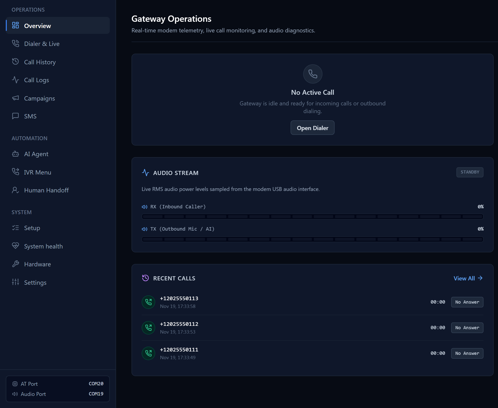
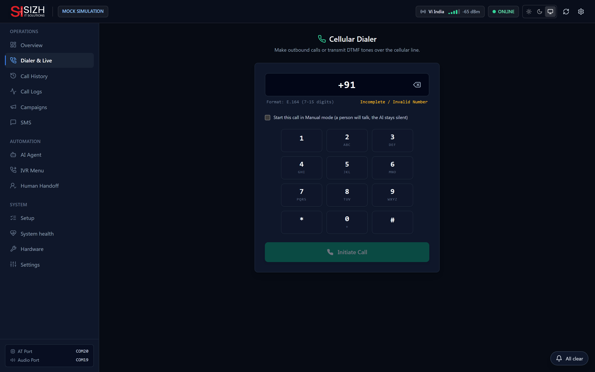
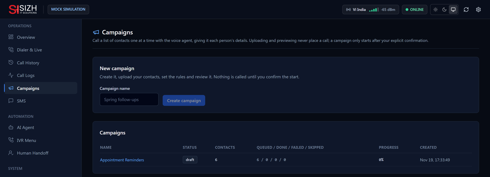
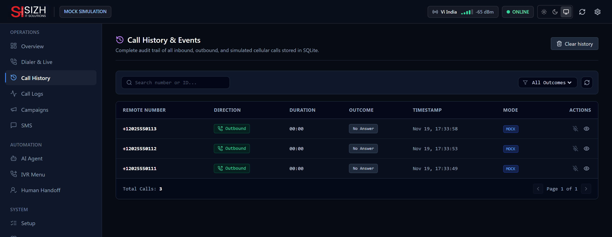
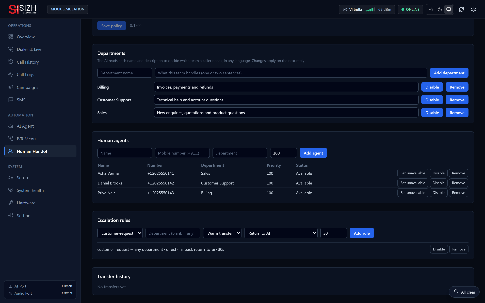
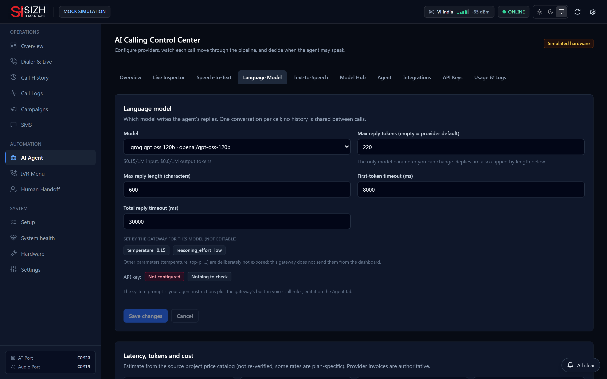
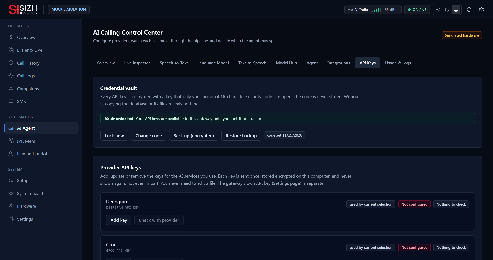

<div align="center">

# SimDial AI

### Intelligent Calling. Automated Conversations.

A desktop platform for AI-assisted calling, campaigns and SMS on your own Windows PC and your own modem.<br>
Developed by **SIZH IT Solutions**.

<br>


<br>

[**Download the latest release &nbsp;→**](https://github.com/sizh-it-solutions/SimDialAI-Released/releases/latest)

<br>



<sub>The SimDial AI dashboard running in simulation mode with demo data. No real calls, contacts or keys are shown.</sub>

</div>

<br>

## What SimDial AI does

SimDial AI turns a USB LTE voice modem and a Windows PC into a phone system you control. It answers and places real phone calls, can let an **AI voice agent** talk on them, lets a person take over at any moment, and keeps a full record of what happened. Everything runs on your computer and is managed from a local web dashboard.

You bring the modem, the SIM card and your own accounts with the speech and language providers you want to use.

<br>

## Features

<table>
<tr>
<td width="50%" valign="top">

**AI voice agent**<br>
Speech-to-text, a language model and text-to-speech joined into a live conversation, with turn-taking and interruption handling. You choose the providers and supply your own API keys.

</td>
<td width="50%" valign="top">

**AI and Manual mode**<br>
Switch a call between the AI agent and a person while it is in progress, or start a call in Manual mode from the dialer.

</td>
</tr>
<tr>
<td valign="top">

**Campaigns**<br>
Upload a contact list (CSV), give the agent each person's details, keep a do-not-call list and review the campaign before it starts. Nothing is dialled until you confirm.

</td>
<td valign="top">

**Human Handoff**<br>
Define departments and the people who can take a call. The AI may offer a transfer, and it is made only after the caller agrees. Off by default; direct transfer only.

</td>
</tr>
<tr>
<td valign="top">

**Credential vault**<br>
Provider API keys are encrypted with a key that only your personal 16-character security code can open. Encrypted backup and restore are included.

</td>
<td valign="top">

**Call history and logs**<br>
A history of every call with its outcome, per-turn logs and latency, and optional call recording that you switch on yourself.

</td>
</tr>
<tr>
<td valign="top">

**SMS**<br>
Read and send text messages through the modem, with tools to check and repair the modem's SMS settings.

</td>
<td valign="top">

**Modem tools and storage**<br>
Port discovery, a modem and driver check, and a simulation mode for trying the dashboard without a modem. Keep your data on the drive you choose, with a verified migration tool.

</td>
</tr>
</table>

Also included: a recorded **IVR menu** for outgoing calls, and a **Setup** checklist that tells you what is still missing.

<br>

## A look inside

<div align="center">

**Dialer**<br>
<br>
<sub>Place a call from the dashboard, optionally in Manual mode so that a person talks and the AI stays silent.</sub>

<br><br>

**Campaigns**<br>
<br>
<sub>Create a campaign, upload your contacts, keep a do-not-call list and review before anything is dialled.</sub>

<br><br>

**Call history**<br>
<br>
<sub>Every call with its direction, duration, outcome and mode.</sub>

<br><br>

**Human Handoff**<br>
<br>
<sub>Departments, the people who can take a call, and the escalation rules.</sub>

<br><br>

**AI settings**<br>
<br>
<sub>Choose the language model and its limits. Speech and voice providers are configured the same way.</sub>

<br><br>

**Credential vault**<br>
<br>
<sub>Provider API keys are protected by your personal security code.</sub>

</div>

<sub>All screenshots were taken from the running application in simulation mode, with fictional names and numbers. Screens on your PC will show your modem, your carrier and your own data.</sub>

<br>

## Install

1. **Download** `SimDialAI-Setup-0.1.8.exe` from the [official Releases page](https://github.com/sizh-it-solutions/SimDialAI-Released/releases/latest).
2. **Verify the checksum** in PowerShell. The result must match exactly:
   ```powershell
   Get-FileHash .\SimDialAI-Setup-0.1.8.exe -Algorithm SHA256
   ```
   ```text
   57732f94e4e1d38bdac2245757ecb1031a879d453941b12b9dbb2ab8c52b4215
   ```
   If it differs, do not run the file.
3. **Run the installer.** It installs for the current Windows user and does not ask for administrator rights. You choose where your data is kept.
4. **Install the Windows driver** for your modem from the modem's maker. SimDial AI does not include it. The Start menu item *Check the modem and driver* tells you what is missing.
5. **Start SimDial AI** and follow the Setup checklist: connect the modem, create your security code and add your provider API keys.

<br>

## Requirements

- Windows 10 or Windows 11, 64-bit.
- A compatible USB LTE voice modem, with its Windows driver installed.
- A SIM card with an active mobile connection and voice service. Features such as call conferencing for Human Handoff depend on your carrier.
- For the AI voice agent: your own accounts and API keys for the speech and language providers you choose.

<br>

## Important notices for version 0.1.8

This is the first public release. Please read these points before you install:

- **The installer is not code-signed.** Windows SmartScreen may show "Windows protected your PC". If the checksum above matches, choose *More info*, then *Run anyway*.
- **Automatic in-app updates are not available in 0.1.8.** To move to a newer version, download and run its setup program.
- **The modem driver is not bundled.** Install it yourself.
- **Windows Sandbox installation testing was not performed** for this release.
- **Real-modem testing was not repeated** with this exact installer.
- **Upgrading over an existing installation was not re-tested** on this build. It is designed to keep your data; back it up first if it matters.
- Human Handoff, the AI agent and call recording are **off by default** and each needs an explicit switch. Recording people may require notice or consent where you are.

The release notes of each version state exactly what was tested and what is known to be missing.

<br>

## About SIZH IT Solutions

SIZH IT Solutions develops SimDial AI. This repository publishes the official customer downloads and contains release files only; it does not contain the application's source code.

<br>

<div align="center"><sub>SimDial AI &middot; &copy; SIZH IT Solutions</sub></div>
